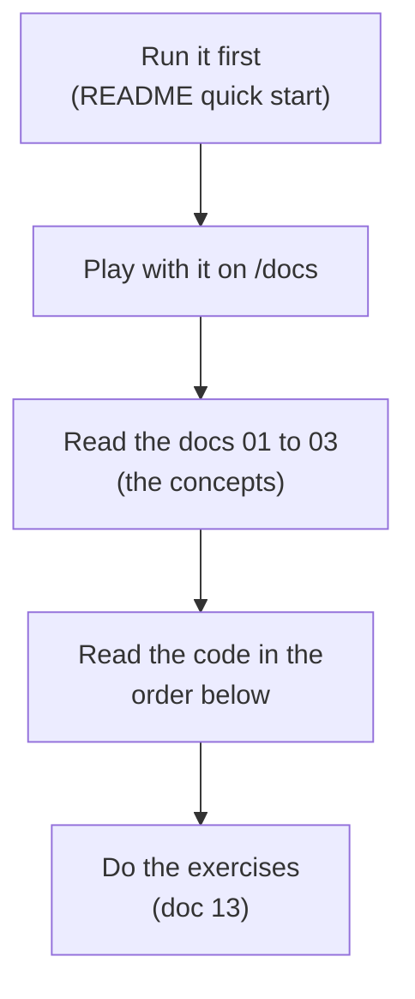
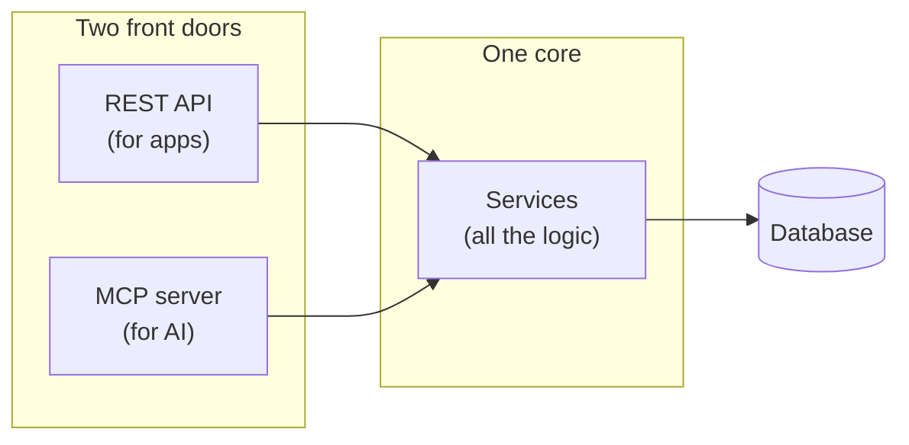

# 0. Start here

This project is built so that **you can learn FastAPI and FastMCP by reading real, working code**.
You do not need to know either of them yet.

## What you need to know before reading

Only basic Python: functions, classes, `if`, `for`, and dictionaries.
Everything else (async, type hints, decorators like `@router.get`) is explained along the way.

## Three ways to learn this project

1. **Run it first.** Seeing it work makes the code much easier to read.
2. **Read docs 01, 02 and 03.** They explain the big picture, FastAPI and MCP in plain words.
3. **Read the code in the order below.** Each file starts with a comment that tells you what it is for.

## The best order to read the code

Start with the small, simple files and move toward the complex ones. Each step uses only things you have already seen.

| Step | File | What you learn | Doc |
|---|---|---|---|
| 1 | `app/config.py` | How settings are read from the environment | [12](12-deployment.md) |
| 2 | `app/models.py` | The 5 database tables | [05](05-database.md) |
| 3 | `app/schemas.py` | The shape of the JSON that goes in and out (Pydantic) | [02](02-fastapi-basics.md) |
| 4 | `app/errors.py` | Our own error types | [04](04-folder-structure.md) |
| 5 | `app/routers/health.py` | The simplest possible FastAPI routes | [02](02-fastapi-basics.md) |
| 6 | `app/services/incidents.py` | The "when is a site down?" rules (pure logic, very readable) | [08](08-incidents-and-alerts.md) |
| 7 | `app/services/checks.py` | How one website is checked | [07](07-monitoring-engine.md) |
| 8 | `app/services/monitors.py` | Create, read, update, delete (CRUD) | [04](04-folder-structure.md) |
| 9 | `app/security.py`, `app/dependencies.py` | Passwords, tokens, "current user" | [06](06-authentication.md) |
| 10 | `app/routers/auth.py`, `monitors.py` | Real routes that use everything above | [02](02-fastapi-basics.md) |
| 11 | `app/services/monitoring.py` | The full recipe for one check | [07](07-monitoring-engine.md) |
| 12 | `app/workers/scheduler.py` | Background loops with asyncio | [07](07-monitoring-engine.md) |
| 13 | `app/mcp_server.py` | The MCP server | [09](09-mcp-server.md) |
| 14 | `app/main.py` | How everything is plugged together | [01](01-big-picture.md) |
| 15 | `tests/` | How we prove it works | [11](11-testing.md) |

## Three ideas that explain the whole project

1. **One core, two front doors.** All logic lives in `app/services/`. The REST API and the MCP server are thin layers that call it. So there is no duplicated logic.
2. **Checks run in the background.** While you use the API, other tasks inside the same app keep checking websites on schedule.
3. **A site is DOWN only after several failures in a row.** This avoids false alarms. The rule is one small function you can read in two minutes.

## Words you will see a lot

Quick meanings (the full list is in [doc 13](13-glossary-and-exercises.md)):

- **Route / endpoint**: a URL the API answers, like `GET /api/v1/monitors`.
- **Schema**: a description of what JSON looks like (and a validator for it).
- **Model**: a class that represents a database table.
- **Service**: a function that does the real work.
- **Session**: one conversation with the database.
- **Tool** (MCP): an action the AI is allowed to run.
