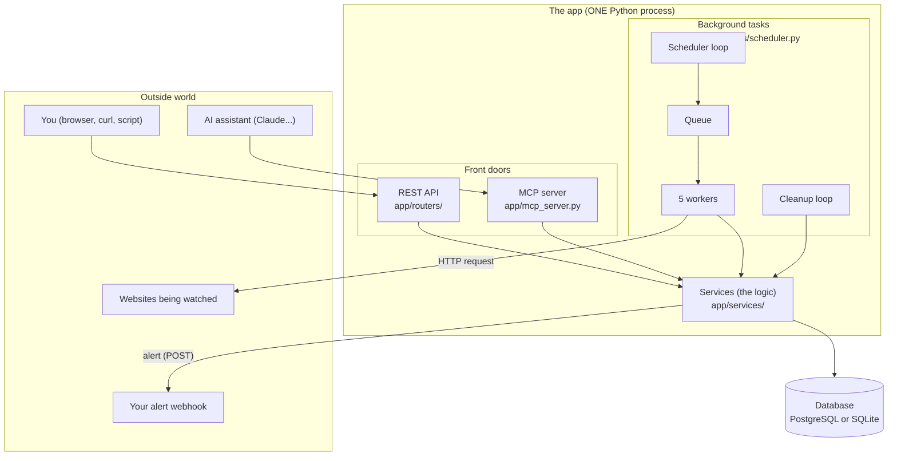
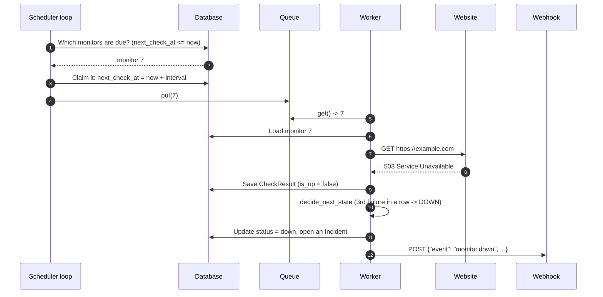
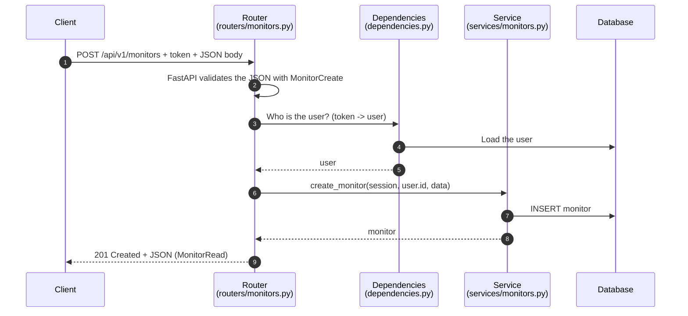
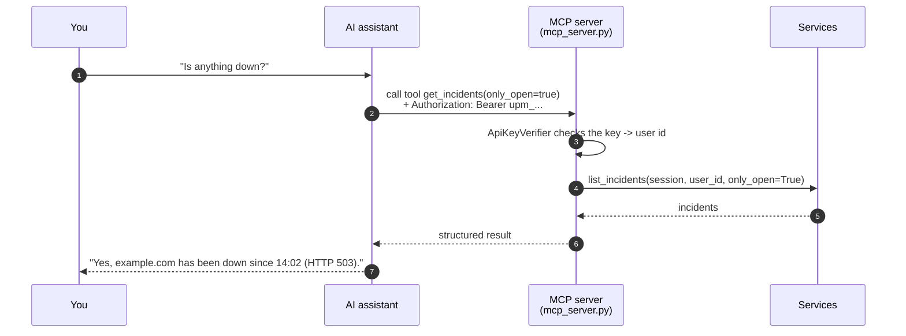

# 1. The big picture

## In one sentence

You tell the app *"watch this website"*, and it checks the site again and again, keeps the history, and warns you when the site goes down or comes back.

## The parts

Everything runs inside one Python process started by `uvicorn app.main:app`.
When it starts, `app/main.py` also starts the background tasks. When it stops, they stop too.

## The life of one check

This is the most important flow in the app. Follow the numbers.

Code for each step:

| Step | Where |
|---|---|
| 1-3 | `claim_due_monitors` in `app/services/monitoring.py`, called by `_scheduler_loop` in `app/workers/scheduler.py` |
| 4-5 | `_worker_loop` in `app/workers/scheduler.py` |
| 6-7 | `perform_http_check` in `app/services/checks.py` |
| 8-10 | `run_check` in `app/services/monitoring.py` and `decide_next_state` in `app/services/incidents.py` |
| 11 | `send_alert` in `app/services/alerts.py` |

## The life of one API request

More detail in [doc 2](02-fastapi-basics.md).

## The life of one MCP call

More detail in [doc 3](03-fastmcp-basics.md) and [doc 9](09-mcp-server.md).

## Key design decisions (and why)

| Decision | Why |
|---|---|
| Logic lives in `services/`, not in routes | The REST API and the MCP server share it. Write once, test once. |
| The database is the source of truth for "what is due" (`next_check_at`) | Nothing is lost if the app restarts, and several copies of the app can share the work. |
| "Claim" a monitor before checking it | Two workers (or two app copies) never check the same monitor at the same time. |
| DOWN only after N failures in a row | One network hiccup should not wake you at 3 am. |
| Alerts are sent *after* the result is saved | A broken webhook can never make us lose data. |
| Async code (`async` / `await`) | One process can wait for many slow websites at the same time. |
| PostgreSQL for production, SQLite for learning and tests | SQLite needs no installation. Tests also pass on PostgreSQL. |
| Pinned library versions | Everyone gets the exact same, tested setup. |

## What is NOT in this project (on purpose)

A frontend, email sending, billing, and multi-region checks. They are natural extensions, see the exercises in [doc 13](13-glossary-and-exercises.md).
