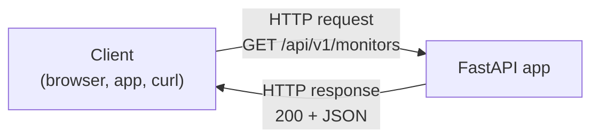
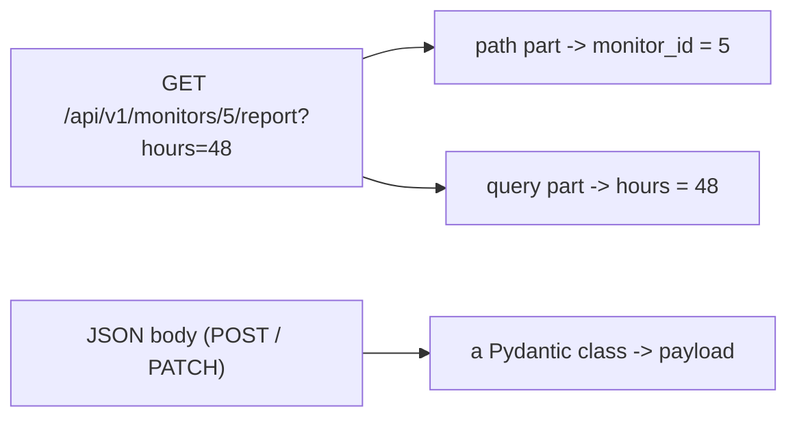
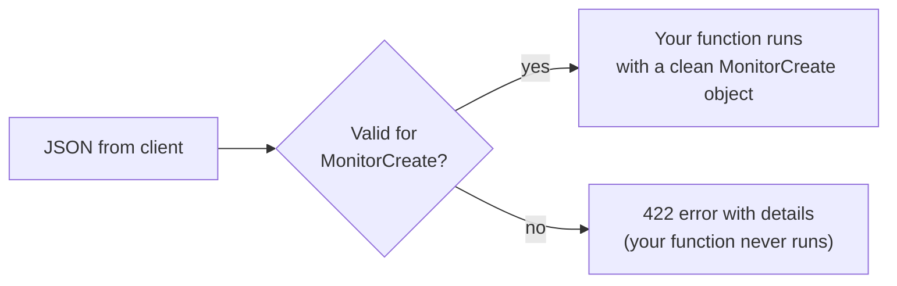
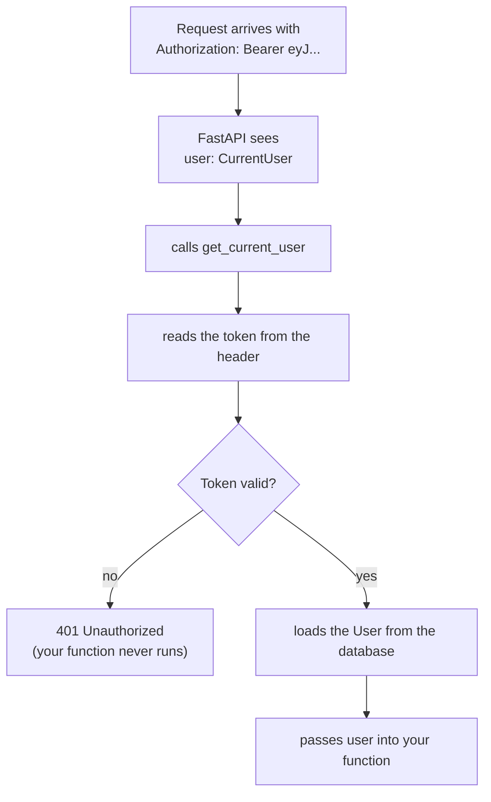
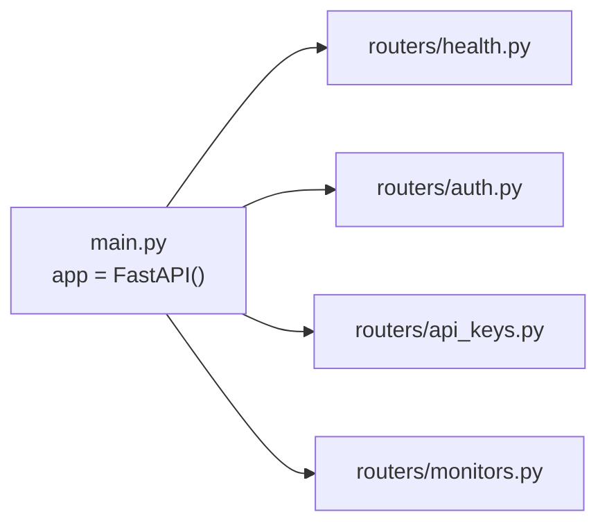
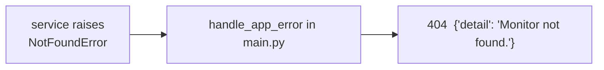

# 2. FastAPI basics (explained with this project)

## What is FastAPI?

FastAPI is a Python library for building **web APIs**.
An API is a menu of URLs that other programs can call. You send a request (like *"give me my monitors"*) and get an answer, usually as **JSON**.



FastAPI does a lot of work for you:

| It automatically... | Because of... |
|---|---|
| Checks that incoming data is valid | Pydantic classes (`schemas.py`) |
| Builds the interactive docs at `/docs` | Your type hints and docstrings |
| Converts your return values to JSON | `response_model` |
| Handles many requests at the same time | `async` functions |

## 1. A route: the smallest example

From `app/routers/health.py`:

```python
@router.get("/health")
async def liveness() -> dict:
    """Returns ok if the app is running."""
    return {"status": "ok"}
```


- `@router.get("/health")` is a **decorator**. It *registers* the function: "when a GET request arrives at `/health`, call this function".
- Other methods exist: `@router.post` (create), `@router.patch` (change), `@router.delete` (remove).

## 2. HTTP methods and status codes

| Method | Meaning in this project | Example |
|---|---|---|
| GET | Read | `GET /api/v1/monitors` |
| POST | Create or do something | `POST /api/v1/monitors` |
| PATCH | Change some fields | `PATCH /api/v1/monitors/5` |
| DELETE | Remove | `DELETE /api/v1/monitors/5` |

| Status | Meaning | Where we use it |
|---|---|---|
| 200 | OK | most reads |
| 201 | Created | after a POST that creates something |
| 204 | OK, nothing to send back | after DELETE |
| 401 | Not logged in / bad token | `AuthenticationError` |
| 403 | Not allowed (limit reached) | `LimitExceededError` |
| 404 | Not found | `NotFoundError` |
| 409 | Conflict (email already used) | `ConflictError` |
| 422 | Input is invalid | Pydantic, or `InvalidInputError` |

## 3. Where does the input come from?

FastAPI looks at the **parameters of your function** to know. This is from `routers/monitors.py`:

```python
@router.get("/monitors/{monitor_id}/report", response_model=UptimeReport)
async def get_report(
    monitor_id: int,          # from the PATH:   /monitors/5/report
    session: SessionDep,      # a dependency (see below)
    user: CurrentUser,        # a dependency (see below)
    hours: int = 24,          # from the QUERY:  ?hours=48
): ...
```



| Where | How you write it | Example |
|---|---|---|
| Path | name appears in `"{...}"` in the route | `monitor_id: int` |
| Query (`?a=1`) | a simple parameter not in the path | `hours: int = 24` |
| Body (JSON) | a parameter whose type is a Pydantic class | `payload: MonitorCreate` |

FastAPI converts types for you: `/monitors/abc` gives a clear 422 error because `monitor_id` must be an `int`.

## 4. Pydantic: validation for free

`app/schemas.py` has classes like this:

```python
class MonitorCreate(BaseModel):
    name: str = Field(min_length=1, max_length=100)
    url: HttpUrl
    interval_seconds: int = Field(default=60, ge=30, le=86400)
```

When a request arrives with `"interval_seconds": 5`, FastAPI answers **422** with a message such as *"Input should be greater than or equal to 30"*. **Our code never runs.** We wrote no `if` statements for this.



The same classes, used as `response_model`, decide **what is sent back**. `UserRead` has no password field, so the password hash can never leak.

## 5. Dependency injection: "ask for what you need"

Many routes need the same things: a database session, the logged-in user. Instead of repeating code, we declare them once in `app/dependencies.py`:

```python
SessionDep  = Annotated[AsyncSession, Depends(get_session)]
CurrentUser = Annotated[User,         Depends(get_current_user)]
```

A route just lists them as parameters:

```python
async def list_monitors(session: SessionDep, user: CurrentUser): ...
```

FastAPI then calls `get_session()` and `get_current_user()` **before** your function and passes the results in.



Two big benefits:
1. **Security by default**: a route without `CurrentUser` is public; with it, it is protected. You cannot forget to check.
2. **Easy testing**: tests can replace a dependency with a fake one.

## 6. Async and await in plain words

```python
async def list_monitors(...):
    monitors = await monitor_service.list_monitors(...)
```

Imagine a waiter in a restaurant. A *blocking* waiter takes an order and stands in the kitchen until the food is ready. An *async* waiter hands the order to the kitchen and serves other tables meanwhile.

- `async def` marks a function that can pause.
- `await` marks the place where it pauses and lets others run (waiting for the database, a website...).
- Rule of thumb: **if a function is `async`, call it with `await`.** Forgetting `await` is the most common beginner mistake.

This is why one process can check dozens of websites at once: while one request waits for a slow site, others make progress.

## 7. Routers: splitting routes into files

A big app with all routes in one file would be unreadable. A `APIRouter` is a group of routes:

```python
router = APIRouter(prefix="/api/v1/monitors", tags=["Monitors"])
```

`app/main.py` plugs each router into the app:

```python
app.include_router(monitors.router)
```



## 8. Lifespan: code that runs at startup and shutdown

In `app/main.py`:

```python
@asynccontextmanager
async def lifespan(app):
    ...startup code (start the workers)...
    yield                      # <- the app serves requests here
    ...shutdown code (stop the workers)...
```

Everything before `yield` runs once when the server starts. Everything after runs once when it stops.

## 9. Error handling

Our services raise `NotFoundError("Monitor not found.")`. `app/main.py` has one function that turns every `AppError` into a JSON answer:



## 10. The free documentation page

Start the app and open `http://localhost:8000/docs`. FastAPI generated it from:
- your routes and their parameters,
- your Pydantic classes,
- the **docstring** of each route function (the `"""..."""` text).

You can click **Try it out** on any endpoint and send real requests. `http://localhost:8000/openapi.json` has the same information in machine-readable form.

## Where to look in the code

| Concept | File |
|---|---|
| Simplest routes | `app/routers/health.py` |
| Body validation, `response_model` | `app/routers/auth.py` |
| Path and query parameters, dependencies | `app/routers/monitors.py` |
| Dependencies | `app/dependencies.py` |
| Pydantic classes | `app/schemas.py` |
| Lifespan, routers, error handler | `app/main.py` |
