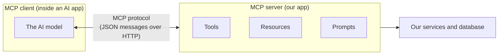
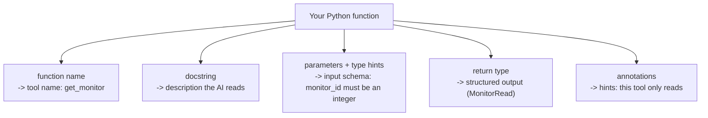
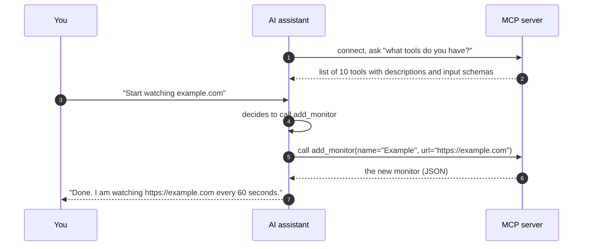
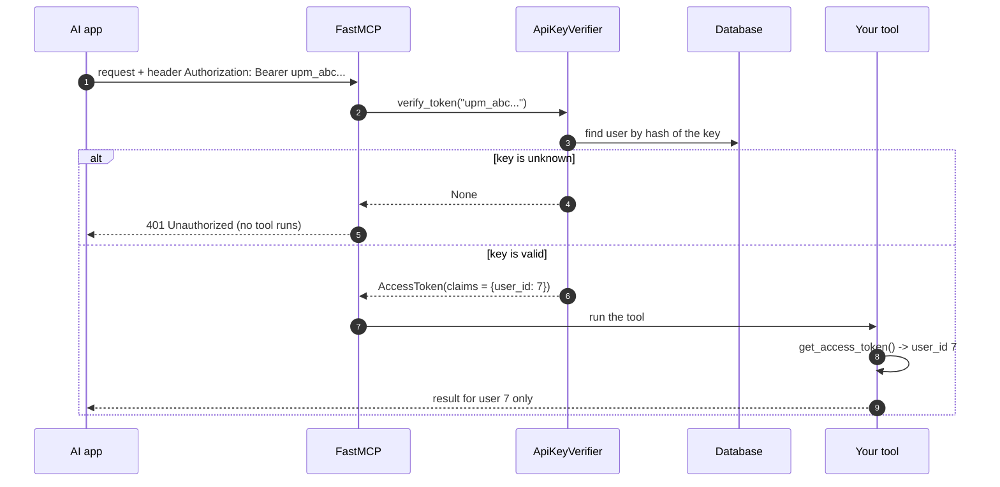
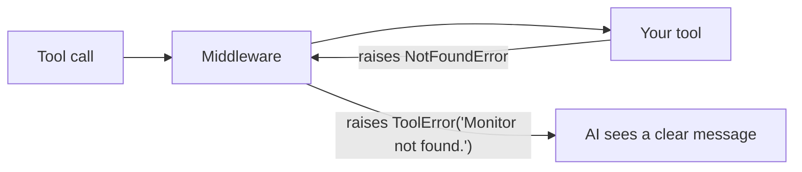
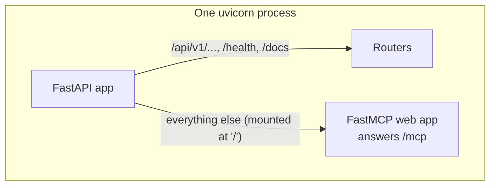
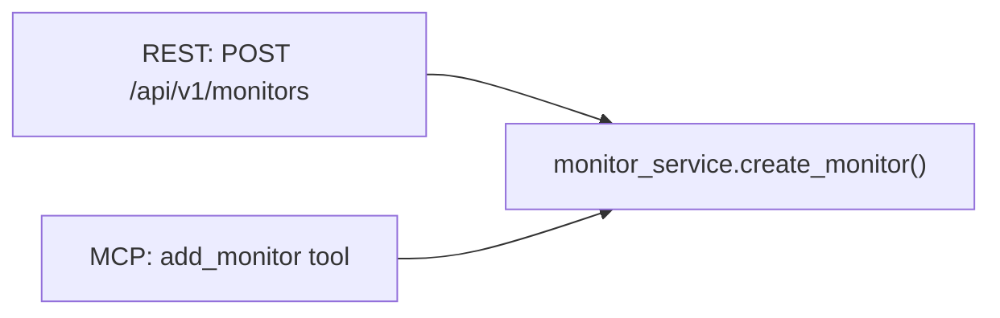

# 3. FastMCP basics

## What is MCP?

**MCP (Model Context Protocol)** is an open standard that lets an AI assistant use outside tools and data.

Think of the USB port. Before USB, every device needed its own special cable. MCP is the "USB port" for AI: **any** MCP-capable assistant can plug into **any** MCP server.



## What is FastMCP?

FastMCP is a Python library for writing MCP servers quickly. You write normal Python functions and add a decorator. FastMCP does the protocol work: describing your tools to the AI, checking inputs, and sending results back.

It is to MCP what FastAPI is to web APIs.

| | FastAPI | FastMCP |
|---|---|---|
| Who calls it? | Apps, browsers, scripts | AI assistants |
| You write | Routes (`@router.get`) | Tools (`@mcp.tool`) |
| Described to the caller by | `/docs` (OpenAPI) | The MCP protocol (tool list) |
| In this project | `app/routers/` | `app/mcp_server.py` |

## The three things an MCP server can offer

| Kind | What it is | Who triggers it | Example in this project |
|---|---|---|---|
| **Tool** | An action. May change data. | The AI decides | `add_monitor`, `get_incidents` |
| **Resource** | Read-only data with an address (a URI) | The app or the user attaches it | `uptime://summary` |
| **Prompt** | A reusable instruction template | The user picks it (like a slash command) | `investigate_incident` |

## A tool in 6 lines

From `app/mcp_server.py` (simplified):

```python
@mcp.tool(annotations={"readOnlyHint": True})
async def get_monitor(monitor_id: int) -> MonitorRead:
    """Get the details and current status of one monitor by its id."""
    async with SessionLocal() as session:
        monitor = await monitor_service.get_monitor(session, _current_user_id(), monitor_id)
        return MonitorRead.model_validate(monitor)
```

FastMCP reads this function and automatically builds the tool description:



> **Very important:** the docstring of a tool is read by the **AI**. It decides *when* to call the tool from that text. So write it like instructions to a smart colleague: what it does, and what the parameters mean.

## How a conversation uses tools



The AI never sees our code. It only sees the tool list. That is why clear descriptions and clear error messages matter.

## Transports: how client and server talk

| Transport | How it works | When used |
|---|---|---|
| stdio | The client starts your program and talks through its input/output | Local tools on your own computer |
| **Streamable HTTP** | Normal HTTP requests to a URL | Servers on a network. **We use this.** |

Because our MCP server is an HTTP endpoint (`/mcp`), it can live inside the same FastAPI app and be protected by keys.

## Authentication

Our MCP server must know **which user** is calling, so that people only see their own monitors.



In code: `ApiKeyVerifier` (a `TokenVerifier`) in `app/mcp_server.py`, and `_current_user_id()` inside every tool. More in [doc 6](06-authentication.md).

## Middleware: code that wraps every call

`ErrorTranslationMiddleware` in `mcp_server.py` wraps every tool call. If a service raises `NotFoundError("Monitor not found.")`, it converts it into a `ToolError` with the same message, so the AI can tell the user something useful.



## How the MCP server lives inside the FastAPI app



Two details in `app/main.py`:
1. `mcp_app = mcp.http_app(path="/mcp")` creates the MCP web app.
2. `app.mount("/", mcp_app)` plugs it in **last**, so the normal routes win first. The MCP app also needs its own startup code, which we run inside our `lifespan` with `async with mcp_app.lifespan(app)`.

## One core, two front doors



Both call the **same function**. The rules (minimum interval, no private addresses, per-user limit) are identical everywhere. See [doc 4](04-folder-structure.md).

## Where to look in the code

| Concept | Where |
|---|---|
| Server object, instructions | `mcp = FastMCP(...)` in `app/mcp_server.py` |
| Tools | `@mcp.tool` functions in `app/mcp_server.py` |
| Resource | `@mcp.resource("uptime://summary")` |
| Prompt | `@mcp.prompt` |
| Auth | `ApiKeyVerifier` |
| Error translation | `ErrorTranslationMiddleware` |
| Mounting | `app/main.py` |
| Tests that talk to it like an AI would | `tests/test_mcp.py` |

Next: [4. Folder structure](04-folder-structure.md) or jump to [9. The MCP server in detail](09-mcp-server.md).
