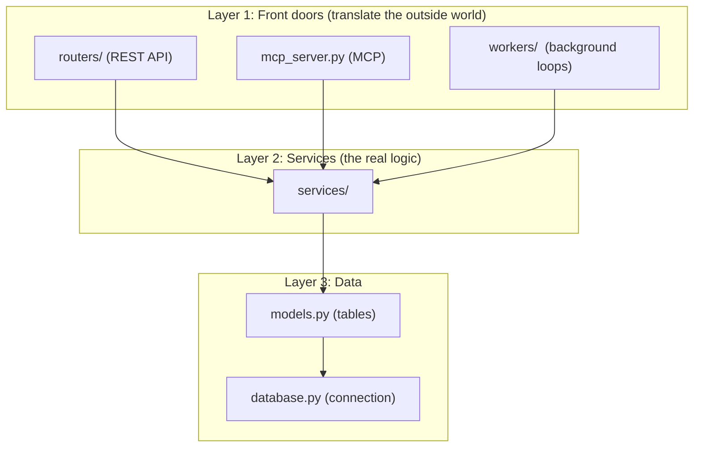
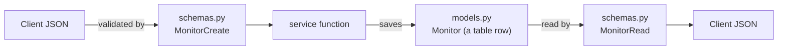
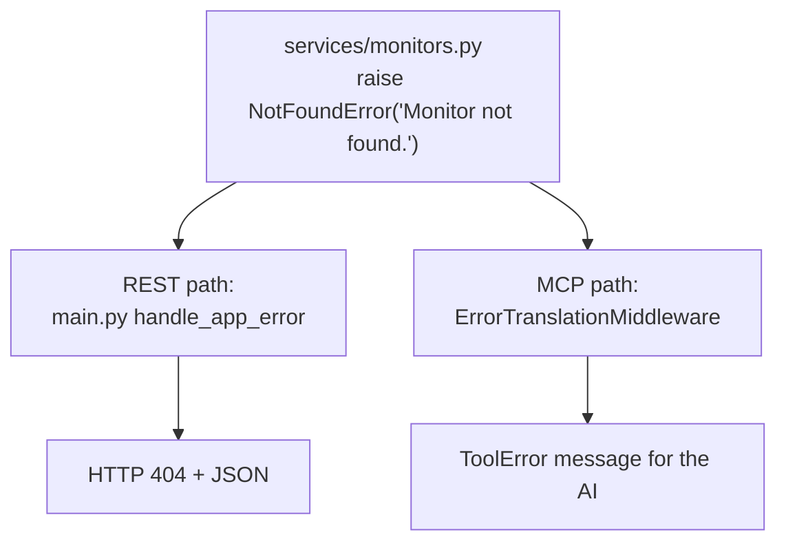

# 4. Folder structure and layers

## The layers

The code is split into layers. **Each layer only talks to the layer below it.**



| Layer | Knows about | Does NOT know about |
|---|---|---|
| Routers | HTTP, JSON, status codes | SQL, how a check works |
| MCP server | tools, AI-friendly errors | HTTP routes, status codes |
| Workers | timing, queues | HTTP, MCP |
| Services | business rules, the database | HTTP, MCP, queues |
| Models | tables and columns | everything else |

**Why?** If you want to change *how an outage is detected*, you open **one** file (`services/incidents.py`) and both the REST API and the MCP server benefit. If the logic lived inside routes, you would fix it twice (and forget one).

## Every file and what it is for

```
app/
├── main.py              Creates the app, plugs in routers, starts workers, mounts MCP
├── config.py            Settings (database URL, secret key, limits) read from the environment
├── database.py          Database engine, session factory, Base class for tables
├── models.py            The 5 tables as Python classes
├── schemas.py           Pydantic classes: the shape of JSON in and out
├── security.py          Hash passwords, create/verify JWT tokens, make API keys
├── dependencies.py      FastAPI dependencies: SessionDep, CurrentUser
├── errors.py            Our own error classes (NotFoundError, ConflictError, ...)
├── mcp_server.py        FastMCP server: tools, resource, prompt, auth
│
├── routers/             THE REST API. Each file = a group of URLs
│   ├── health.py          /health, /health/ready
│   ├── auth.py            register, login, me
│   ├── api_keys.py        create / list / revoke API keys
│   └── monitors.py        monitors, checks, incidents, reports, summary
│
├── services/            THE LOGIC. Plain async functions, no HTTP knowledge
│   ├── users.py           register_user, authenticate_user
│   ├── api_keys.py        create_api_key, find_user_id_by_key, ...
│   ├── monitors.py        create/list/get/update/delete monitors, list check results
│   ├── incidents.py       decide_next_state (the DOWN rule), open/close/list incidents
│   ├── checks.py          perform_http_check (one request to a website)
│   ├── monitoring.py      run_check (the full recipe), claim_due_monitors, cleanup
│   ├── alerts.py          send_alert (webhook)
│   ├── reports.py         uptime_report, get_summary
│   ├── http_client.py     the safe HTTP client used for all outgoing requests
│   └── url_safety.py      blocks private addresses (SSRF protection)
│
└── workers/
    └── scheduler.py       Scheduler loop, worker loop, cleanup loop (asyncio)
```

## Models vs schemas: the most common confusion



| | `models.py` | `schemas.py` |
|---|---|---|
| Library | SQLAlchemy | Pydantic |
| Describes | A database table | JSON in the API |
| Example | `Monitor` has `consecutive_failures` | `MonitorRead` shows it, `MonitorCreate` does not accept it |
| Why separate | We never want to expose internal columns (like `hashed_password`) or accept fields the user must not set (like `status`). |

## How an error travels



Services raise neutral errors from `errors.py`; each front door translates them its own way.

## Rules of thumb used in this code

1. **Routers are thin**: receive, call a service, return. No logic.
2. **Services take a session and plain values**, and return model objects.
3. **Every query that touches user data filters by `user_id`.** A user can never read another user's data.
4. **Services commit** their own changes (`await session.commit()`), so each service call is one complete unit of work.
5. **Time is always UTC** (`utcnow()` in `models.py`).

## Where to add things

| I want to... | Change |
|---|---|
| Add an API endpoint | a function in `routers/`, calling a service |
| Add logic | a function in `services/` |
| Add a column or table | `models.py` + a migration ([doc 5](05-database.md)) + `schemas.py` |
| Add an AI tool | a function in `mcp_server.py`, calling a service ([doc 9](09-mcp-server.md)) |
| Add a setting | `config.py` (and `.env.example`) |
