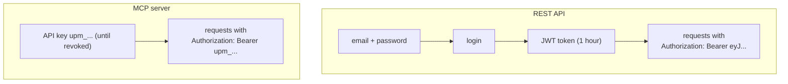
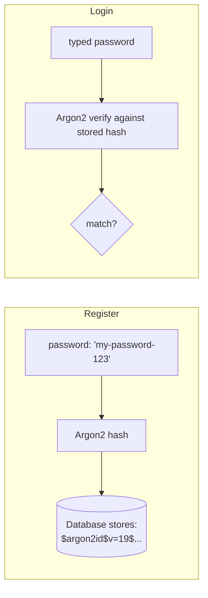
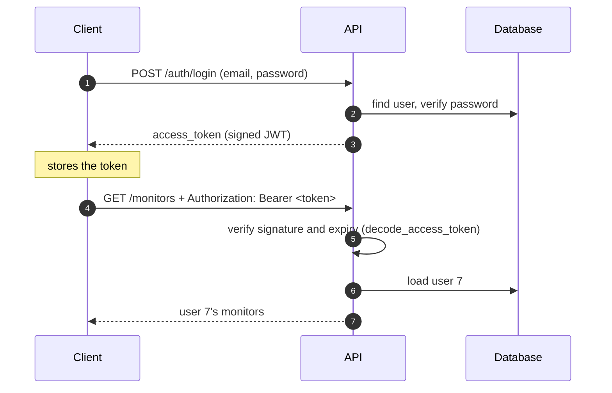
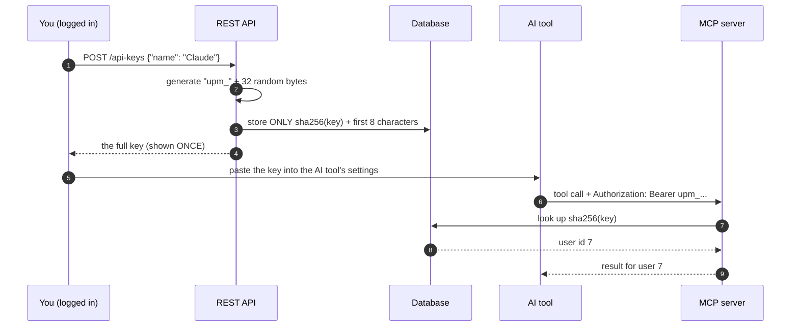
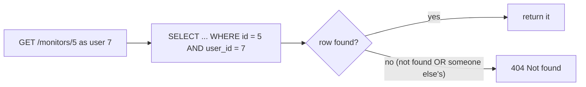

# 6. Authentication

**Authentication** answers: *"Who are you?"*. This app has two ways to prove it, for two different callers.

| Caller | Proves identity with | Lasts | Created by |
|---|---|---|---|
| A person or app using the REST API | A **JWT login token** | 60 minutes | `POST /auth/login` |
| An AI tool using MCP | An **API key** (`upm_...`) | Until revoked | `POST /api-keys` |



The two are **not interchangeable**: an MCP key does not work on REST routes, and a login token does not work on MCP (there is a test for it).

## 1. Passwords: never store them



- A **hash** is a one-way scramble. You can turn a password into a hash, but not a hash back into a password.
- **Argon2** is a modern, *deliberately slow* algorithm, so an attacker who steals the database needs huge effort to guess passwords.
- Code: `hash_password` and `verify_password` in `app/security.py`.

**Same answer for "unknown email" and "wrong password".** In `authenticate_user` (`services/users.py`) we run the slow check even when the email does not exist, and return the identical message. Otherwise an attacker could discover which emails are registered by comparing responses or timing.

## 2. Login tokens (JWT)

A **JWT** (JSON Web Token) is a piece of text with three parts: a header, a payload, and a signature.

```
eyJhbGciOiJIUzI1NiJ9 . eyJzdWIiOiI3IiwiZXhwIjoxNzMxfQ . 3pQx...
      header                   payload (readable!)          signature
```

The payload says `{"sub": "7", "exp": 1731...}`: *"this is user 7, valid until this time"*.
The signature is made with our `SECRET_KEY`. If anyone changes the payload (say, `"sub": "1"`), the signature no longer matches and we reject the token.



Good to know:
- The payload is **readable by anyone** (it is only encoded, not encrypted). Never put secrets in it. We only put the user id.
- **Whoever knows `SECRET_KEY` can forge tokens.** That is why production refuses to start with a weak one ([doc 12](12-deployment.md)).
- Tokens cannot be cancelled before they expire. That is acceptable for 60 minutes; a refresh-token system is a possible extension ([doc 10](10-security.md)).
- Code: `create_access_token`, `decode_access_token` in `app/security.py`; `get_current_user` in `app/dependencies.py`.

## 3. API keys for MCP

Why not reuse the login token? A token expires in an hour and is meant for a person. An AI tool needs something long-lived that you can **revoke on its own** without logging out everywhere.



- **Shown once.** We store only a hash, exactly like a password, so even we cannot show the key again. If you lose it, delete it and make a new one.
- SHA-256 is fine for keys (unlike passwords) because they are long and random, so they cannot be guessed. It also lets us find a key by its hash in the database instantly.
- `key_prefix` (first 8 characters, like `upm_a1B2`) lets you recognise which key is which in the list.
- `DELETE /api-keys/{id}` stops it working immediately.
- `last_used_at` is updated at most once a minute (so we do not write on every call).
- Code: `generate_api_key`, `hash_api_key` in `security.py`; `services/api_keys.py`; `ApiKeyVerifier` in `mcp_server.py`.

## 4. Authorization: "what are you allowed to do?"

Authentication says *who you are*. **Authorization** says *what you may touch*. Here the rule is simple: **you may only touch your own data.**



Every service query includes `user_id`. For someone else's monitor we answer **404, not 403**, so attackers cannot even learn which ids exist. Tests: `test_users_cannot_see_or_change_each_others_monitors` and `test_users_only_see_their_own_monitors_through_mcp`.

## Quick reference

| Question | Answer |
|---|---|
| How long does a login token last? | `ACCESS_TOKEN_EXPIRE_MINUTES`, default 60 |
| What algorithm signs tokens? | HS256 (HMAC with SHA-256) |
| What happens if I lose my API key? | Delete it and create a new one |
| Can an API key use the REST API? | No, only the MCP server accepts API keys |
| Where is the secret key? | `SECRET_KEY` setting (`.env`) |

## Where to look in the code

| Topic | File |
|---|---|
| Hash / verify / JWT / key generation | `app/security.py` |
| Login logic | `app/services/users.py` |
| "Current user" for REST | `app/dependencies.py` |
| Key storage and lookup | `app/services/api_keys.py` |
| "Current user" for MCP | `ApiKeyVerifier`, `_current_user_id` in `app/mcp_server.py` |
| Tests | `tests/test_auth.py`, `tests/test_api_keys.py`, `tests/test_mcp.py` |
