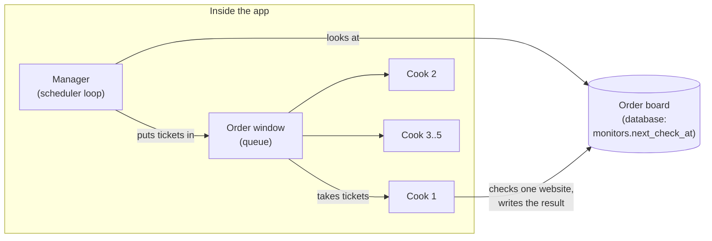
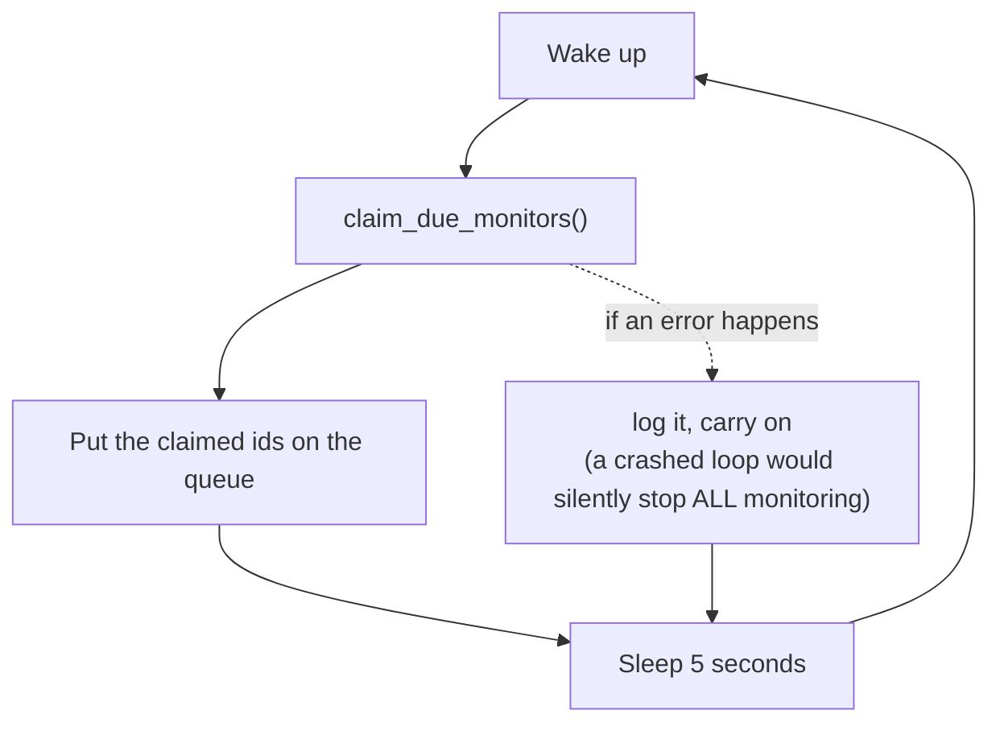
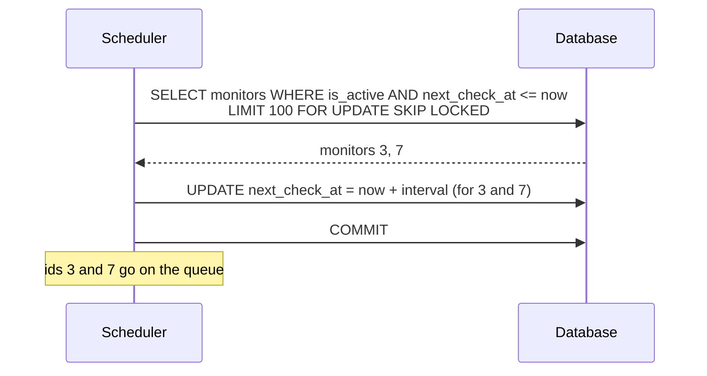
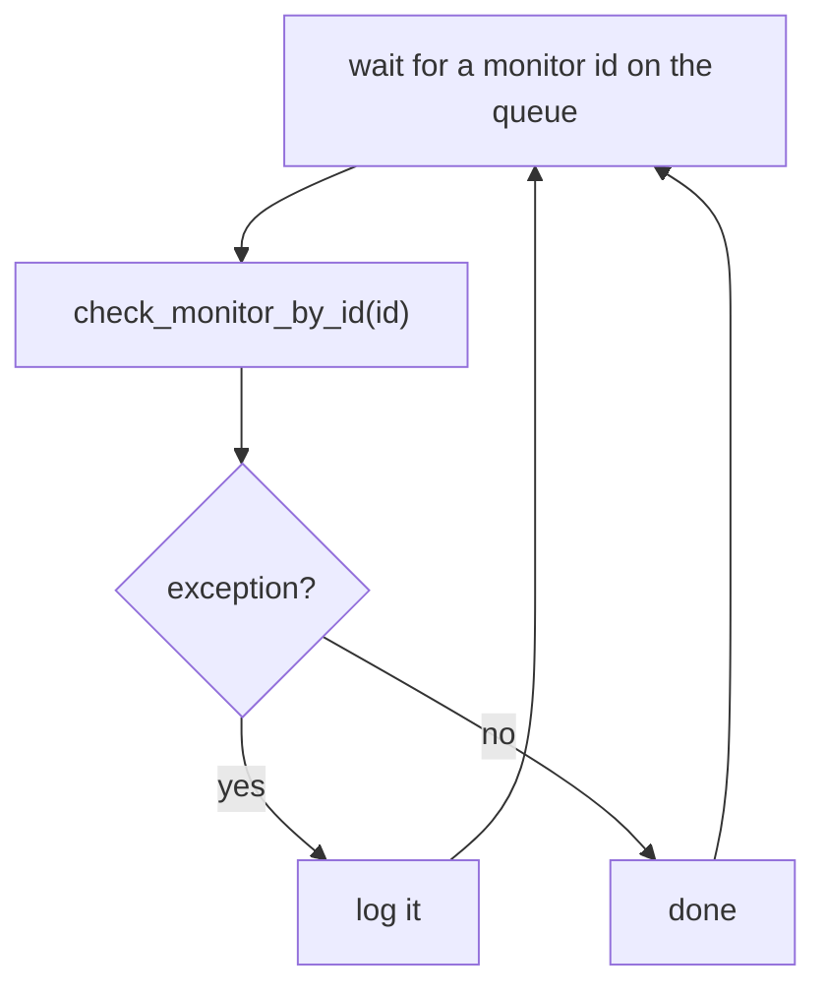
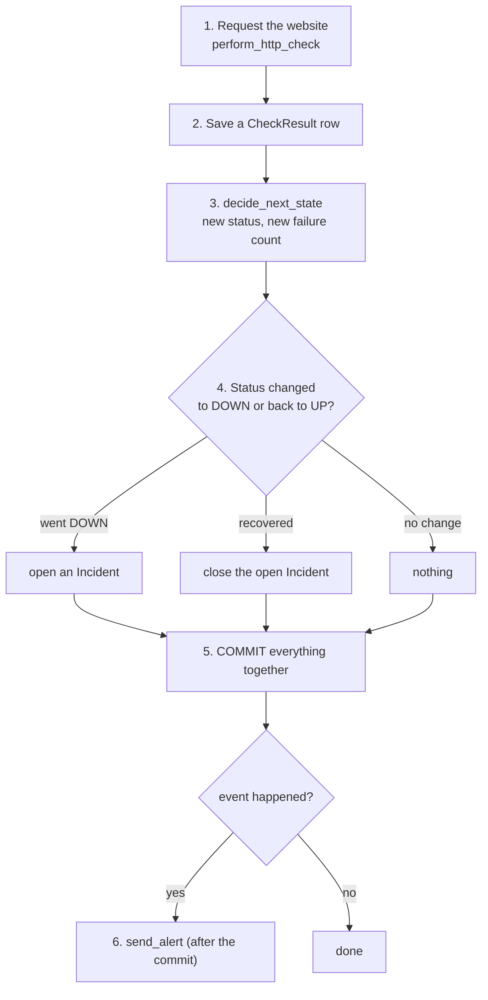
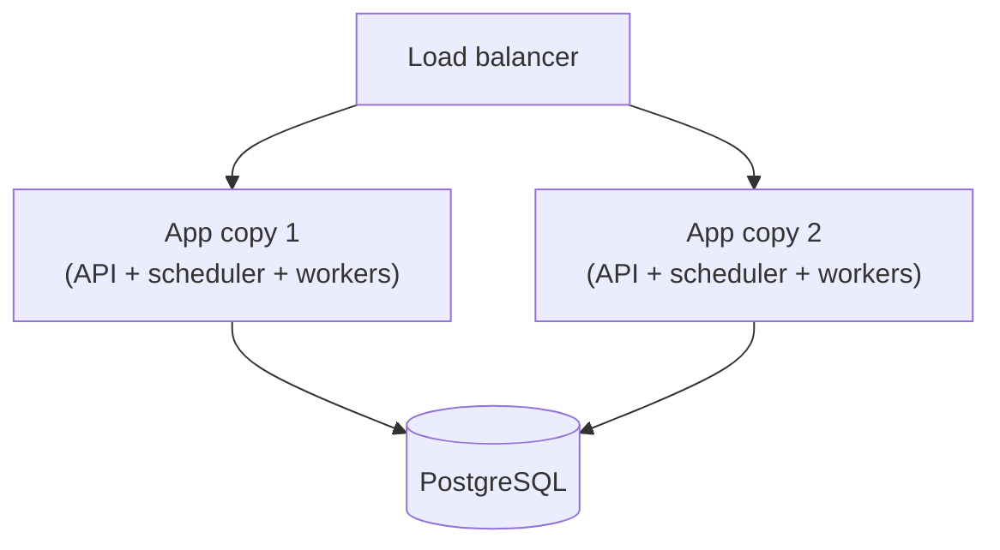

# 7. The monitoring engine

This is how the app checks websites **by itself**, in the background, while it also serves API requests.

## The restaurant analogy

| Restaurant | App | Code |
|---|---|---|
| Order board | The `monitors` table, `next_check_at` column | `app/models.py` |
| Manager | Scheduler loop | `Scheduler._scheduler_loop` |
| Order window | `asyncio.Queue` | `Scheduler._queue` |
| Cooks | Worker loops (`WORKER_COUNT`, default 5) | `Scheduler._worker_loop` |
| Cleaner | Cleanup loop (hourly) | `Scheduler._cleanup_loop` |

All of them are **asyncio tasks** inside the same Python process. They start in `lifespan` (`app/main.py`) and stop when the app stops.

## The scheduler loop

Every `SCHEDULER_INTERVAL_SECONDS` (default 5):

### "Claiming" a monitor

`claim_due_monitors` in `services/monitoring.py`:

Why move `next_check_at` **before** checking?

- The monitor is no longer "due", so the next scheduler pass will not queue it again while a worker is still busy with it.
- If you run **two copies of the app** on PostgreSQL, `FOR UPDATE SKIP LOCKED` makes each copy skip rows the other is claiming. Nothing is checked twice.

Trade-off, stated honestly: if the app crashes after claiming but before checking, that one check is skipped. The monitor is checked again one interval later. This is "at most once" behaviour, which is fine for monitoring.

## A worker

A worker never dies from one bad check, because the loop catches every exception.

## The recipe for one check (`run_check`)

Two details worth knowing:

1. **We commit before the HTTP request** (the first line of `run_check`). That sounds odd, but it ends the open database transaction and gives the connection back to the pool while we wait up to 10 seconds for a slow website. Otherwise 5 slow checks could hold 5 database connections doing nothing.
2. **Alerts are sent after the final commit.** A broken webhook can never cause a lost result.

## What does "checked" mean?

`perform_http_check` (`services/checks.py`) sends a `GET` request and compares the status code with `expected_status` (default 200).

| What happened | Result | Recorded `error` |
|---|---|---|
| Status equals expected | UP | none |
| Different status (503, 404...) | DOWN | `Expected status 200 but got 503` |
| No answer within `REQUEST_TIMEOUT_SECONDS` | DOWN | `Timed out after 10 seconds` |
| DNS failure, connection refused, SSL error | DOWN | `ConnectError: ...` |
| URL points to a private address | DOWN | `Private or local addresses are not allowed.` |

Details:
- We use **streaming** (`client.stream`): we read only the headers, never download the whole page.
- Up to **5 redirects** are followed; each hop is checked for safety ([doc 10](10-security.md)).
- Response time is measured until the headers arrive.

## Cleanup

Once an hour, `delete_old_results` deletes `check_results` older than `CHECK_RETENTION_DAYS` (default 30). Without this, the table would grow forever: 100 monitors checked every minute make 144,000 rows a day.

## Settings that control the engine

| Setting | Default | Effect |
|---|---|---|
| `RUN_BACKGROUND_WORKERS` | `true` | `false` = API only, no checks (used by tests) |
| `SCHEDULER_INTERVAL_SECONDS` | 5 | How often due monitors are looked up. Also the maximum delay of a check. |
| `WORKER_COUNT` | 5 | How many websites can be checked at the same time |
| `REQUEST_TIMEOUT_SECONDS` | 10 | When a slow site counts as down |
| `CHECK_RETENTION_DAYS` | 30 | How long history is kept |

## How many monitors can it handle?

Rough capacity: `WORKER_COUNT / average_check_seconds` checks per second.
Example: 5 workers and sites that answer in 0.5 s → about 10 checks per second → about 600 per minute → roughly 600 monitors at a 60-second interval. Raise `WORKER_COUNT` (checks are mostly waiting, so 50 to 100 workers is fine) before scaling anything else.

## Scaling further

On PostgreSQL you can simply run more copies. `SKIP LOCKED` keeps them from doing the same work. Things to know:
- On **SQLite** do not run more than one copy.
- The queue is in memory. If the app restarts, queued ids are lost; they come back one interval later (see trade-off above). The database is the real source of truth.
- Beyond thousands of monitors per instance, consider moving workers to separate processes and the queue to Redis. The service functions would not change.

## Try it yourself

1. Start the app and create a monitor (`interval_seconds: 30`).
2. Watch the logs. The check result appears in `GET /api/v1/monitors/{id}/checks` after a few seconds, and a new one every 30 seconds.
3. Pause the monitor (`PATCH ... {"is_active": false}`). No more checks. Resume it: a check happens within seconds.

## Where to look in the code

| Topic | File |
|---|---|
| Background loops | `app/workers/scheduler.py` |
| Claiming, the full recipe, cleanup | `app/services/monitoring.py` |
| One HTTP check | `app/services/checks.py` |
| Tests, including a real scheduler run | `tests/test_monitoring.py` |
