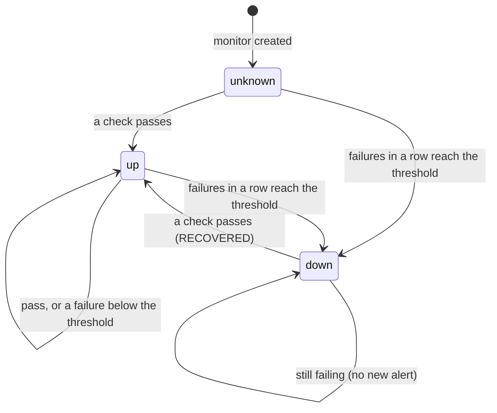
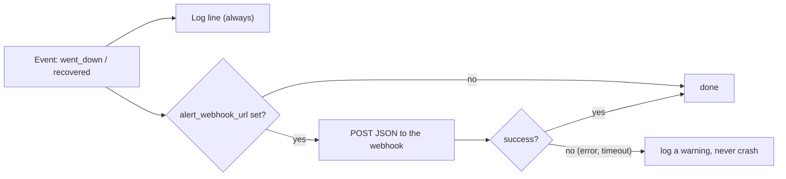

# 8. Incidents and alerts

## The problem

Networks are not perfect. One failed check can be a random hiccup. If we alerted on every single failure, you would get false alarms all the time.

**Our rule:** a monitor is DOWN only after `failure_threshold` failed checks **in a row** (default 3). One success resets the counter.

## The state machine

A monitor is always in one of three states.



Two **events** are worth telling the user about (`StatusEvent` in `services/incidents.py`):

| Event | When | What we do |
|---|---|---|
| `went_down` | The monitor **becomes** DOWN | open an incident, send an alert |
| `recovered` | A DOWN monitor passes a check | close the incident, send an alert |

Everything else (still up, still down) produces **no event**, so you never get repeated alerts for the same outage.

## The rule as code

The whole rule is one small "pure" function, `decide_next_state` in `app/services/incidents.py`:

```python
def decide_next_state(current_status, consecutive_failures, check_passed, failure_threshold):
    if check_passed:
        event = RECOVERED if current_status == DOWN else None
        return NextState("up", 0, event)

    failures = consecutive_failures + 1
    if failures >= failure_threshold:
        event = WENT_DOWN if current_status != DOWN else None
        return NextState("down", failures, event)

    return NextState(current_status, failures, None)   # failing, but not often enough yet
```

"Pure" means it only looks at its inputs: no database, no network. That makes it trivial to test (`tests/test_incident_logic.py`).

## A worked example (threshold = 3)

| Check # | Website answers | failures in a row | status after | Event |
|---|---|---|---|---|
| 1 | 200 OK | 0 | up | none |
| 2 | 503 | 1 | up | none |
| 3 | 503 | 2 | up | none |
| 4 | 503 | 3 | **down** | **went_down** (incident opened, alert sent) |
| 5 | 503 | 4 | down | none (no repeated alert) |
| 6 | 200 OK | 0 | **up** | **recovered** (incident closed, alert sent) |

## How long until I am alerted?

`interval_seconds × failure_threshold` (roughly). With the defaults, 60 s × 3 = about 3 minutes.
Want faster alerts? Lower the interval or set `failure_threshold` to 1 or 2. Fewer false-alarm protections, faster alarms: your choice per monitor.

## Incidents

An **incident** is one outage: a row in the `incidents` table.

```mermaid
gantt
    title One incident on a timeline
    dateFormat HH:mm
    axisFormat %H:%M
    section Website
    Healthy           :done, 14:00, 14:02
    Failing (not yet DOWN)  :active, 14:02, 14:05
    DOWN (incident open)    :crit, 14:05, 14:20
    Healthy again     :done, 14:20, 14:30
```



| Field | Meaning |
|---|---|
| `started_at` | When the monitor became DOWN |
| `resolved_at` | When it recovered. **`null` means still happening** |
| `reason` | The error of the check that triggered it, e.g. `Expected status 200 but got 503` |

Find them: `GET /api/v1/incidents?only_open=true` (ongoing), or the MCP tool `get_incidents`.

## Alerts

When an event happens, `send_alert` (`services/alerts.py`) does two things:

1. Writes a log line (always).
2. If the monitor has an `alert_webhook_url`, sends it a JSON `POST`.



### The webhook message

```json
{
  "event": "monitor.down",
  "monitor": { "id": 7, "name": "My website", "url": "https://example.com/" },
  "reason": "Expected status 200 but got 503",
  "occurred_at": "2026-11-16T14:05:12.482113+00:00"
}
```

`event` is `monitor.down` or `monitor.recovered`.

> **Heads-up about Slack, Discord and Teams.** They expect messages in their *own* JSON formats (for example Slack wants `{"text": "..."}`), so they will not show our payload nicely as it is. Two easy options: send the webhook to an automation tool (n8n, Zapier, Make) that reformats it, or add a small formatter in `alerts.py` (this is exercise 7 in [doc 13](13-glossary-and-exercises.md)). A generic JSON payload is the right default because it works with any receiver you write yourself.

### Why alerts are sent last

In `run_check`, the result, the status and the incident are **saved first** (one commit). Only then is the alert sent. If the webhook is slow or broken, you still have every fact in the database.

## Pausing and incidents

If you pause a monitor while an incident is open, the incident stays open and the status stays `down` until you resume it and a check passes. (Possible extension: close incidents automatically when pausing.)

## Where to look in the code

| Topic | File |
|---|---|
| The DOWN rule, incident helpers | `app/services/incidents.py` |
| Putting it together | `run_check` in `app/services/monitoring.py` |
| Webhook | `app/services/alerts.py` |
| Tests | `tests/test_incident_logic.py`, `tests/test_monitoring.py` |
