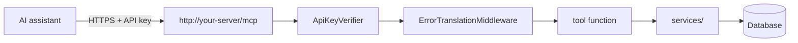

# 9. The MCP server in detail

The MCP server lets an AI assistant manage your monitors through conversation. Concepts first: [doc 3](03-fastmcp-basics.md). This page is the reference.

## Where it lives



- Endpoint: `/mcp` (Streamable HTTP), on the same port as the REST API.
- File: `app/mcp_server.py`.
- Auth: `Authorization: Bearer upm_...` ([doc 6](06-authentication.md)).

## Tools

| Tool | Inputs | What it does | Changes data? |
|---|---|---|---|
| `list_monitors` | none | All your monitors with their status | no |
| `get_monitor` | `monitor_id` | One monitor's details | no |
| `add_monitor` | `name`, `url`, `interval_seconds` (default 60) | Start monitoring a site | **yes** |
| `pause_monitor` | `monitor_id` | Stop checking, keep history | **yes** |
| `resume_monitor` | `monitor_id` | Start checking again | **yes** |
| `delete_monitor` | `monitor_id` | Delete monitor and history | **yes (destructive)** |
| `check_now` | `monitor_id` | Check immediately and return the result | **yes** (records a check) |
| `get_recent_checks` | `monitor_id`, `limit` (default 10) | Latest checks with status codes, times, errors | no |
| `get_incidents` | `monitor_id` (optional), `only_open`, `limit` | Outages, newest first | no |
| `get_uptime_report` | `monitor_id`, `hours` (default 24) | Uptime %, average speed, incident count | no |

## Resource

| URI | Content |
|---|---|
| `uptime://summary` | JSON: total monitors, how many up / down / unknown / paused, open incidents |

## Prompt

| Name | Input | Effect |
|---|---|---|
| `investigate_incident` | `monitor_id` | Gives the AI step-by-step instructions to investigate a failing monitor and explain it simply |

## Tool "hints" (annotations)

```python
@mcp.tool(annotations={"readOnlyHint": True})     # never changes anything
@mcp.tool(annotations={"destructiveHint": True})  # deletes data
```

AI apps use these hints to decide when to ask you for confirmation. Read-only tools can run freely; destructive ones are usually confirmed with you first.

## Connecting a client

1. Create an API key (`POST /api/v1/api-keys`). The full key is shown once.
2. Point the client at `http://localhost:8000/mcp` (or `https://your-domain/mcp` in production) with the header `Authorization: Bearer upm_...`.

```bash
# Claude Code
claude mcp add --transport http uptime http://localhost:8000/mcp \
    --header "Authorization: Bearer upm_YOUR_KEY"
```

```jsonc
// Claude Desktop (claude_desktop_config.json), using the mcp-remote bridge
{
  "mcpServers": {
    "uptime": {
      "command": "npx",
      "args": ["mcp-remote", "http://localhost:8000/mcp",
               "--header", "Authorization: Bearer upm_YOUR_KEY"]
    }
  }
}
```

Client setup screens and commands change often. If something differs, check your client's documentation for "remote MCP server with a custom header". The URL and header are all it needs.

### Test without any AI: the MCP Inspector

```bash
npx @modelcontextprotocol/inspector
```

Choose transport **Streamable HTTP**, URL `http://localhost:8000/mcp`, add the header `Authorization: Bearer upm_...`, then **Connect** and **List Tools**. You can call each tool by hand and see the raw results.

### Test from Python

`scripts/smoke_test.py` does exactly what an AI tool does:

```python
from fastmcp import Client
from fastmcp.client.transports import StreamableHttpTransport

transport = StreamableHttpTransport("http://localhost:8000/mcp", auth="upm_YOUR_KEY")
async with Client(transport) as client:
    tools = await client.list_tools()
    result = await client.call_tool("list_monitors", {})
```

## Example conversations

| You say | The AI probably calls |
|---|---|
| "What am I monitoring?" | `list_monitors` |
| "Start watching https://myblog.com" | `add_monitor` |
| "Is anything down right now?" | `get_incidents` with `only_open=true` |
| "Why is monitor 3 failing?" | `get_monitor`, `get_recent_checks`, `get_incidents` (or the `investigate_incident` prompt) |
| "Uptime of my API this week?" | `get_uptime_report` with `hours=168` |
| "Pause monitoring while I deploy" | `pause_monitor` |

## Adding your own tool (3 steps)

Example: a tool that lists only the monitors that are down.

**1. Make sure a service exists.** `list_monitors` already exists. For something new, add the logic to `app/services/` first (never in the tool itself).

**2. Write the tool in `app/mcp_server.py`:**

```python
@mcp.tool(annotations={"readOnlyHint": True})
async def list_down_monitors() -> list[MonitorRead]:
    """List only the monitors that are currently down."""
    async with SessionLocal() as session:
        monitors = await monitor_service.list_monitors(session, _current_user_id(), limit=200)
        return [MonitorRead.model_validate(m) for m in monitors if m.status == "down"]
```

**3. Test it** in `tests/test_mcp.py` (copy a nearby test).

Tips for good tools:
- **Docstring = instructions to the AI.** Say what it does and what the inputs mean.
- Use **simple parameter types** (`int`, `str`, `bool`). Give defaults for optional ones.
- Return **structured** data (Pydantic models), not paragraphs of text.
- Raise our `AppError` classes for failures. The middleware turns them into clear messages.
- Keep the number of tools small and purposeful. A handful of well-described tools beats dozens of overlapping ones.

## How errors look to the AI

| Situation | The AI sees |
|---|---|
| Monitor id does not exist (or is not yours) | `Monitor not found.` |
| Invalid URL in `add_monitor` | `Invalid input: ...` |
| Private address | `Private or local addresses are not allowed.` |
| Too many monitors | `You can have at most 50 monitors.` |
| Wrong or revoked API key | HTTP 401 before any tool runs |

## Troubleshooting

| Problem | Cause and fix |
|---|---|
| 401 Unauthorized | Wrong or revoked key, a login token used instead of an API key, or a missing `Bearer ` prefix |
| Connection refused | The app is not running, or wrong port |
| Tools list is empty or stale | Reconnect the client (many clients cache the tool list) |
| Works locally but not in a hosted AI app | Hosted apps need a public **HTTPS** URL; `localhost` is only reachable from your own machine |

## Where to look in the code

| Topic | File |
|---|---|
| Everything MCP | `app/mcp_server.py` |
| Mounting into FastAPI | `app/main.py` |
| End-to-end MCP tests | `tests/test_mcp.py` |
| Live demo against a running server | `scripts/smoke_test.py` |
