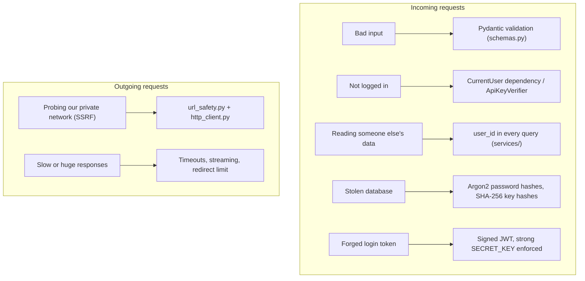
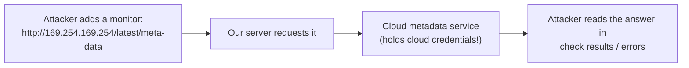
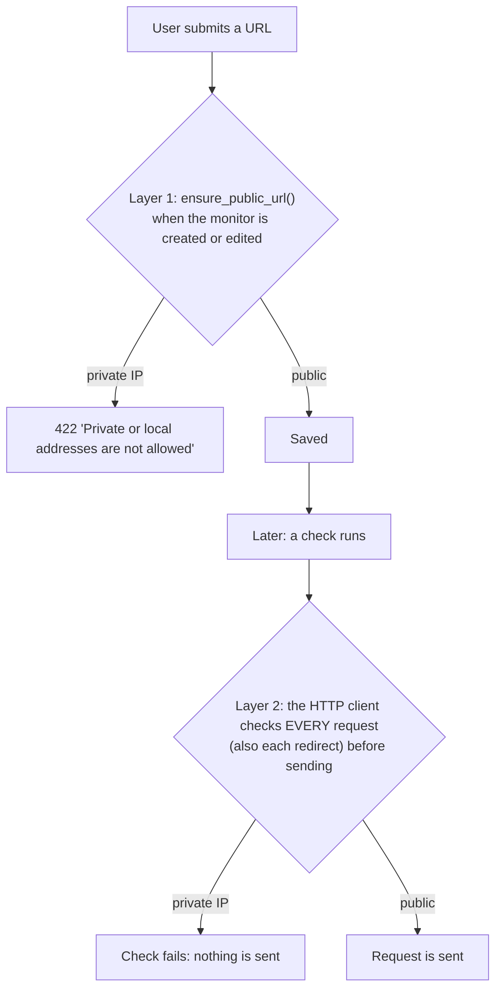

# 10. Security

A security review in plain words: what we protect against, where, and what we do **not** cover.

## Protections at a glance

| Threat | Protection | Where | Test |
|---|---|---|---|
| Invalid or oversized input | Field limits (password max 128, name max 100, interval 30 to 86400...) | `schemas.py` | `test_register_rejects_bad_input`, `test_create_monitor_rejects_bad_input` |
| Anonymous access | Token / key required | `dependencies.py`, `mcp_server.py` | `test_protected_route_needs_a_token` |
| Reading or editing other users' data | `user_id` filter + 404 | `services/*.py` | `test_users_cannot_see_or_change_each_others_monitors` |
| Password theft from the database | Argon2 hashes | `security.py` | `test_register_returns_user_without_password` |
| Finding out which emails exist | Same message and timing for unknown email and wrong password | `services/users.py` | `test_login_with_wrong_password_or_unknown_email_fails_the_same_way` |
| Forged / expired tokens | Signature + expiry check | `security.py` | `test_expired_token_is_rejected`, `test_token_signed_with_another_secret_is_rejected` |
| API key theft from the database | Only the hash is stored | `services/api_keys.py` | `test_secret_is_not_stored_in_plain_text` |
| Weak secret in production | App refuses to start | `config.py` | `test_production_refuses_the_default_secret` |
| SSRF | Private addresses blocked | `url_safety.py` | `test_private_addresses_are_blocked` |
| Resource abuse by one user | Max monitors per user, min interval 30 s | `services/monitors.py`, `schemas.py` | `test_monitor_limit_per_user` |
| Running as root in Docker | Non-root user | `Dockerfile` | n/a |

## SSRF explained

**SSRF = Server-Side Request Forgery.** Our server makes web requests to addresses that users type. A malicious user could type an address that only our server can reach, and use our server as a proxy:

Our defence, in two layers:

How the check works: resolve the host name to its IP addresses, and refuse if **any** of them is not a normal public address (`ipaddress.ip_address(...).is_global`). That covers localhost, `10.x`, `172.16-31.x`, `192.168.x`, link-local `169.254.x`, IPv6 loopback, and more.

## Honest limitations

A tutorial project should be honest about what it does not do. For a real production system, consider these.

| Limitation | Impact | What to do |
|---|---|---|
| **DNS rebinding.** An attacker-controlled domain can answer with a public IP during our check, then a private IP when the real request happens. | A determined attacker might still reach a private address. | Pin the resolved IP for the real request (custom transport), or run the workers in a network with no access to internal systems (best defence). |
| **No rate limiting** on login or registration | Password guessing is possible | Add limiting at the reverse proxy (nginx, Cloudflare) or with a library such as `slowapi`. |
| **No email verification or password reset** | Anyone can register any email | Add an email flow if you open registration publicly. |
| **JWT cannot be revoked** before expiry (60 min) | A stolen token works until it expires | Short lifetime (already), refresh tokens, or a token blocklist. |
| **API keys have full user access** | A leaked key can do everything the user can | Add key scopes (read-only keys), expiry dates. |
| **No HTTPS in the app itself** | Tokens and keys travel in clear text without TLS | Always run behind a TLS-terminating reverse proxy in production ([doc 12](12-deployment.md)). |
| **No CORS configuration** | Browsers on other sites cannot call the API | Correct for a backend-only service. Add `CORSMiddleware` only if you build a web frontend. |
| **Webhook payloads are not signed** | A receiver cannot verify that a message really came from us | Add an HMAC signature header (exercise in [doc 13](13-glossary-and-exercises.md)). |
| **MCP server has no per-tool permissions** | Any valid key may call any tool, including delete | Use read-only keys (future), rely on client confirmation for destructive hints. |
| **Monitored URLs and error texts are stored and returned** | Not a vulnerability itself, but never render them as HTML without escaping in a future frontend | Escape output in any UI. |

## Security checklist before going live

- [ ] `ENVIRONMENT=production` and a random `SECRET_KEY` of at least 32 characters
- [ ] PostgreSQL with a strong password, not reachable from the internet
- [ ] HTTPS in front of the app (reverse proxy or platform)
- [ ] `ALLOW_PRIVATE_URLS` is **not** set to true
- [ ] Rate limiting on `/api/v1/auth/*` at the proxy
- [ ] Regular database backups
- [ ] Logs are collected and watched
- [ ] Dependencies updated regularly ([doc 12](12-deployment.md))

## Never commit secrets

`.env` and `*.db` are in `.gitignore`. If a secret was ever committed by accident, **change it**: removing it from git history is not enough.
