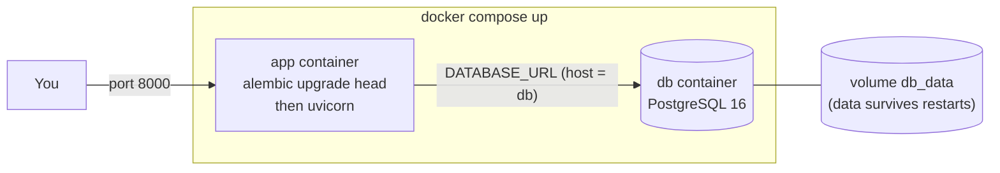
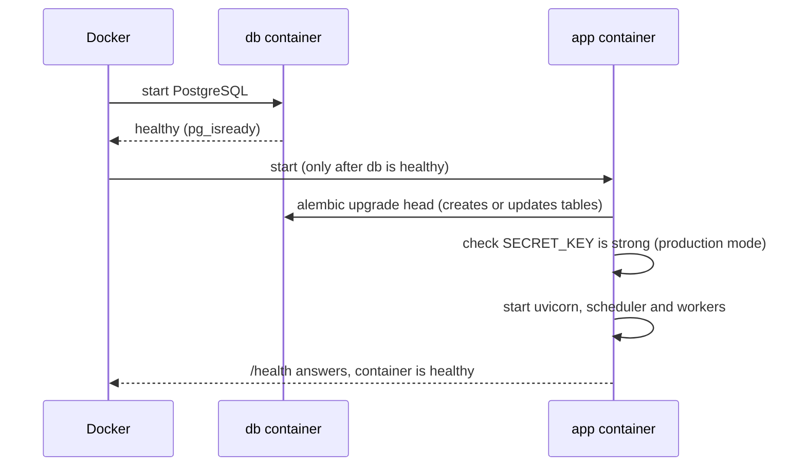
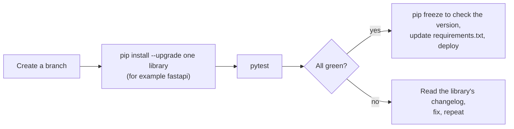

# 12. Deployment and configuration

## All settings

Settings are read from environment variables (or the `.env` file). They are defined in `app/config.py`.

| Setting | Default | Meaning |
|---|---|---|
| `ENVIRONMENT` | `development` | `production` enables strict safety checks |
| `DATABASE_URL` | `sqlite+aiosqlite:///./uptime.db` | Where data is stored. Use PostgreSQL in production |
| `SECRET_KEY` | insecure dev value | Signs login tokens. **Required and 32+ characters in production** |
| `ACCESS_TOKEN_EXPIRE_MINUTES` | 60 | Login token lifetime |
| `RUN_BACKGROUND_WORKERS` | `true` | `false` = API only |
| `SCHEDULER_INTERVAL_SECONDS` | 5 | How often to look for due monitors |
| `WORKER_COUNT` | 5 | Parallel checks |
| `REQUEST_TIMEOUT_SECONDS` | 10 | Time before a site counts as not answering |
| `CHECK_RETENTION_DAYS` | 30 | History kept |
| `MAX_MONITORS_PER_USER` | 50 | Per-user limit |
| `ALLOW_PRIVATE_URLS` | `false` | **Keep false.** Only true for local experiments and tests |

Environment variable names are the setting names in capitals. A real environment variable always wins over `.env`.

## Option A: run locally (development)

```bash
pip install -r requirements-dev.txt
cp .env.example .env
alembic upgrade head
uvicorn app.main:app --reload
```

## Option B: Docker Compose (app + PostgreSQL)



```bash
cp .env.example .env
# edit .env: set SECRET_KEY and POSTGRES_PASSWORD
docker compose up --build        # start
docker compose logs -f app       # watch logs
docker compose down              # stop (data kept)
docker compose down -v           # stop and DELETE the data
```

What happens on start:



Notes about the Dockerfile:
- Libraries are installed **before** the code is copied, so rebuilds after a code change are fast (Docker caches the slow step).
- The app runs as a **non-root user**.
- A `HEALTHCHECK` calls `/health`.

## Option C: your own server or a cloud platform

Any platform that runs a container (Fly.io, Railway, Render, Google Cloud Run, AWS ECS, a VPS with Docker...) works. You need:

1. A **PostgreSQL** database and its `DATABASE_URL` (must start with `postgresql+asyncpg://`).
2. The environment variables `ENVIRONMENT=production` and `SECRET_KEY=...`.
3. **HTTPS** in front of the app. Most platforms provide it; on a VPS use Caddy or nginx with Let's Encrypt.
4. The platform's health check pointing to `/health` (liveness) and `/health/ready` (readiness).

> **Cloud Run and "scale to zero" platforms:** background workers need the process to stay alive. Set a minimum of 1 instance, otherwise monitoring stops while the app sleeps. Alternatively run one always-on instance for monitoring.

## Running behind a reverse proxy (example Caddyfile)

```
uptime.example.com {
    reverse_proxy localhost:8000
}
```

Caddy gets and renews the HTTPS certificate automatically. For nginx, remember to allow long-lived connections for `/mcp`.

## Scaling

| Goal | How |
|---|---|
| More checks per second | Increase `WORKER_COUNT` |
| More API capacity | More app copies behind a load balancer (PostgreSQL only) |
| Several copies | Each copy runs its own scheduler and workers; claiming with `SKIP LOCKED` prevents double checks ([doc 7](07-monitoring-engine.md)) |

If you start uvicorn with several processes (`--workers 4`), each process also runs its own scheduler. That is fine on PostgreSQL, but not on SQLite.

## Database operations

| Task | How |
|---|---|
| Apply migrations | `alembic upgrade head` (Docker does it automatically on start) |
| Backup | `pg_dump` on a schedule (or your provider's automatic backups) |
| Restore | `psql` / `pg_restore` into an empty database, then `alembic current` to confirm the version |
| Change tables | Edit `models.py`, `alembic revision --autogenerate`, review, commit, deploy ([doc 5](05-database.md)) |

Rolling out a migration: with one instance, deploy the new image (it migrates on start). With several instances, run `alembic upgrade head` once as a separate step before starting the new ones, and make migrations **backward compatible** (add columns, do not rename them in the same release).

## Logs and monitoring the monitor

- Logs go to standard output (what Docker and platforms collect). Alerts appear as `ALERT monitor=...` lines.
- Use `/health/ready` as the readiness probe. It fails with 503 if the database is unreachable.
- Pro tip: monitor your uptime monitor with an **external** one. A service watching itself cannot tell you when it is down.

## Upgrading libraries safely

All versions are pinned in `requirements.txt`.



Upgrade one library at a time so you know what broke. FastMCP and the MCP SDK evolve quickly, so read their release notes before upgrading.

## Production checklist

- [ ] `ENVIRONMENT=production`, strong `SECRET_KEY` (the app will refuse to start otherwise)
- [ ] PostgreSQL, not SQLite; database not exposed publicly
- [ ] HTTPS in front
- [ ] `ALLOW_PRIVATE_URLS` unset or `false`
- [ ] Backups configured and a restore tested
- [ ] Health checks configured
- [ ] Rate limiting on login at the proxy
- [ ] At least one always-running instance (workers need it)
- [ ] An external uptime check for the service itself
